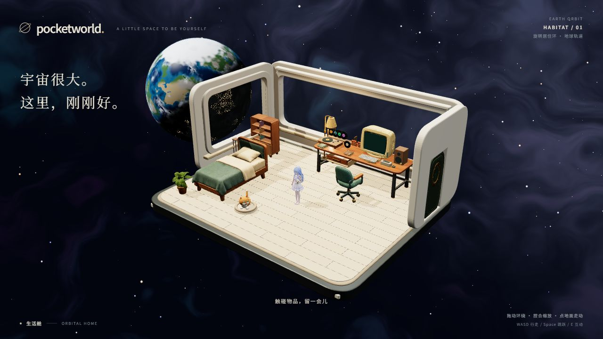

# 15 个提供素材的场景替换

以 `main` 的 `a7cf978` 为基线，已在 `codex/model-replacement` 接入 15 个素材。修改集中在家具外观及其资源加载层；房间布局、外层交互节点、相机、灯光参数、人物、游戏、UI、存储与公共接口保持原代码。原始 `3d素材` 文件未覆盖。



## 素材对应

运行资源位于 `public/models/replaced/`。`.parts` 文件保留可分别选择的命名部件；`.fitted` 表示对原有接触位置适配过的外壳副本。

| 用户素材 | 运行文件 | 接入位置与处理 |
| --- | --- | --- |
| 本子 | planner.parts.glb | 日程书；书体、封面拆分，原日程纸页保留 |
| 舱门 | hatch.glb | 原舱门锚点与朝向 |
| 唱片机 | turntable.parts.glb | 替换机身；原可旋转唱盘、唱针和音频控制保留 |
| 床 | bed.glb | 原床位与躺卧流程 |
| 灯 | lamp.parts.glb | 替换灯体；灯罩适配原灯泡与拉绳坐标 |
| 电脑 | computer.fitted.glb | 外壳开口适配原 0.92 × 0.69 屏幕 |
| 柜子 | cabinet.parts.glb | 柜体、柜门拆分；层板适配原书位 |
| 滑轮椅 | rolling-chair.parts.glb | 底座、上半部拆分；沿用移动、旋转、座面下降 |
| 键盘 | keyboard.parts.glb | 替换底壳；原响应按键的键帽与字符保留 |
| 盆栽 | plant.glb | 两舱原盆栽锚点；原浇水反馈保留 |
| 日记本 | journal.parts.glb | 书体、封面拆分；原编辑与翻页保留 |
| 收纳盒 | storage-box.glb | 沿用原取出/放回轨迹 |
| 椅子 | lounge-chair.parts.glb | 观景舱椅子，底座、座椅拆分 |
| 游戏卡带 | cartridge.glb | 两种游戏共用提供的外壳；原颜色图形标记保留 |
| 桌子 | desk.parts.glb | 桌体与抽屉拆分；沿用原抽屉行程 |

为了保持原交互接触位置，家具使用各轴尺寸适配；盆栽保持等比缩放。书本和键盘纠正了源文件自带的倾斜/旋转。提供的闭合模型没有完整内壁，因此抽屉内衬、柜体内部、门背、书封内侧和唱片机顶板使用原有几何方式补齐。这些是外观模型适配，不修改动画状态机。

加载期间或资源失败时显示原外观。每个实例复制节点与可见性，共享只读几何和材质，避免两个场景或两个运动部件相互影响。命名部件选择兼容 glTF 多材质导出产生的 Group + 多个 Mesh 层级。

## 验证与边界

- `npm test`：225 项通过，0 失败，包含既有交互/日程/书库/媒体测试及 2 项实例隔离回归。
- 最后一次 JSX 调整后再次执行 `npm run build`：TypeScript 和生产构建通过。保留原有 Three.js 大块提示，未新增依赖。
- Blender 5.2.3 LTS 新进程重新导入实际运行的 15 个 GLB：全部通过，坐标有限，UV/材质存在，贴图最大 2048，单文件低于 10 MiB。详见 [fresh-import.json](fresh-import.json)。
- 最终 15 个运行 GLB 合计 **40,086,604 bytes（38.23 MiB）**、**779,390 个三角面**。这是全部资产之和，不是单帧渲染统计。未使用的完整中间模型已移出 public，不进入生产包。
- 内置浏览器实际页面检查：1280 × 720 默认场景、电脑进入/退出、卡带拖入并加载「团团魔法录」、日记编辑入口、床上休息；390 × 844 竖屏检查显示正常，页面控制台无错误或警告。未写入日记内容。
- 独立可视检查入口调用生产家具组件，检查抽屉、两本书、柜门和收纳盒开合、两类椅子与座面下降、灯具、缺失资源回退。它使用测试状态，不能替代全部用户操作路径。
- **未验证**：实体手机/Safari、低端 GPU 帧率、长时间压力、所有极端姿态穿插，以及其他未合并角色/椅子/翻页 PR 的集成。本分支没有合入这些并行任务。

截图：[电脑](evidence/computer.jpg)、[抽屉与书本](evidence/desk-open.jpg)、[柜门](evidence/cabinet-open.jpg)、[床](evidence/bed.jpg)、[灯](evidence/lamp.jpg)、[竖屏](evidence/mobile.jpg)。

## 本地查看

在本任务工作区运行 `npm run dev -- --host 127.0.0.1 --port 5190 --strictPort`，内置浏览器访问 `http://127.0.0.1:5190/`。

- 实际页面：`/`
- 可视动作检查：`/art/model-replacement/motion-check.html`
- 资源单独查看：`/art/model-replacement/gallery.html`

后两个只供 Vite 开发期检查，没有增加产品 UI 或生产入口。结束预览后关闭服务。

## 重新生成

需要 Blender 与本地原始 15 个 GLB。默认读取当前用户桌面的 `3d素材`，也可设置环境变量 `POCKETWORLD_MODEL_SOURCE`。从仓库根目录依次执行：

```powershell
$blender = 'F:\blender.exe'
& $blender --background --python art/model-replacement/process.py
& $blender --background --python art/model-replacement/articulate.py
& $blender --background --python art/model-replacement/fit_computer.py
& $blender --background --python art/model-replacement/pack_textures.py
& $blender --background --python art/model-replacement/verify.py
& ./art/model-replacement/archive-intermediates.ps1
```

`generated/` 保存可编辑 `.blend`、处理日志数据及未拆分 GLB 副本，体积较大，仅留在本地并由 Git 忽略。上述脚本从原素材生成副本，不修改原件；手工修改过的生成文件应先另存。运行 GLB、脚本、回读报告与验收截图随分支交付。

本地保留的 `integrate.py` 只是首次源码迁移记录，已忽略且不属于生成步骤，不应重复执行。PR 合并由项目维护者审查后处理。
