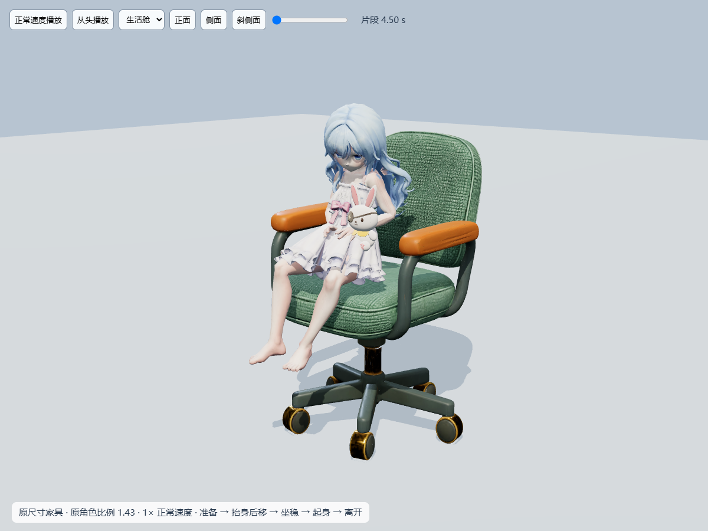

# Luna 原尺寸椅子动作与验收

用户截图推翻了前一版视觉验收：`fe60abe` 把两舱椅子缩为 0.56，臀部 / 后裙摆仍进入坐垫。旧的 237 项测试、踝锚点误差和旧录像不能证明座面接触合格。本页与 `review/` 已替换为修复后的证据。



## 尺寸与动作契约

Three.js Y 向上、人物 +Z 向前，以下均为场景单位。角色比例仍为 1.43，原 `luna-walk-room.glb` 的网格、115 骨架、蒙皮、材质和 Walk 未改。

| 家具 | main 原尺寸（宽×高×深） | 被否决版本 | 修复后静止尺寸 |
| --- | --- | --- | --- |
| 生活舱滚轮椅 | 0.90 × 1.40 × 0.90 | 0.504 × 0.784 × 0.504 | 0.90 × 1.40 × 0.90 |
| 观景舱扶手椅 | 1.04 × 1.40 × 1.00 | 0.5824 × 0.784 × 0.56 | 1.04 × 1.40 × 1.00 |

`HabitatFurniture.tsx` 与 main 的家具尺寸 / 变换代码一致，删除 `CHAIR_SCALE`；家具 GLB 未改。真实坐垫中心射线高度约为 0.7822 / 0.7456。源动作站立髋部约 0.728、坐稳约 0.445，不能直接下降到原尺寸高座面并强制双脚落地。

- 准备站距：生活舱 0.68、观景舱 0.745，保证完整裙摆在座面前方再进入动作。
- 保留源上身准备与前倾，重新烘焙高座面适配：约 1 秒释放地面接触，抬身；1.4–2.75 秒后移 0.55；3 秒坐稳，髋部高度 0.944。静坐双脚悬垂。观景舱在转移时渐进降低身体 0.037，匹配较低的独立座面。
- 3–6 秒余弦往返待机；0.24 秒混合。起身以 1.35 倍反向回放当前坐下段。保留点击 / E 入座、E / Esc 中断、点地面起身续走、重复入座和点击 `stopPropagation` 修复。
- 滑椅先向前缘移 0.14，再伸腿蹬地。气杆行程从 main 的 0.25 改为 **0.35**，身体额外沉降 0.01；静坐后回到原高度，家具没有缩放。蹬地行程收为 0.03–0.09，以真实髋部解两骨 IK，保留骨长与臀部支撑。
- 后裙跟随坐姿折叠，伸腿时保持臀后布料在座面上的姿态；后发保留有限姿态修正，兔子保持原手掌抓握点。未改相机、隐藏网格或移动标记点来掩盖穿模。

## 验证

`npm test` 完成类型检查、生产构建和 **240/240** 测试。新增 `chair-surface-review.mjs` 将实际变形后的全部角色三角形与完整椅子上半部（坐垫、扶手、靠背）进行 BVH 三角形相交检查，不以骨骼或包围盒代替表面。

| 检查 | 结果 |
| --- | --- |
| 两舱各 0–6 秒、48 Hz、289 姿态 | 三角形交叉面为 0；反向回放使用相同姿态 |
| 原身体顶点 19863 / 19865 的臀部支撑间隙 | 生活舱 0.00397–0.00775；观景舱 0.00576–0.01071；不是裙摆尖端或标记 |
| 进入 / 退出混合 | 权重 0 / 0.25 / 0.5 / 0.75 / 1 均无交叉面 |
| 滑椅 | 3 / 4.5 / 5.5 秒姿态 × 73 个前缘 / 蹬地样本无交叉面，臀部间隙 <0.02 |
| 滑椅中取消 | 121 个反向恢复样本无交叉面 |
| 蹬地双脚 | 每脚实际蒙皮最低点均在 −0.002～0.006 容差内；额外测量最低值约 −0.000255 |
| 骨长与退出恢复 | 原骨段长度保留、坐姿有限值正常、退出恢复原 Walk |
| 生活舱 Chrome | 真实鼠标点击、完整坐起、重复入座、下降中 Esc、WASD、地面点击起身抵达目标；异常 0 |
| 观景舱 Chrome | 现有 travel 动作切舱后，真实鼠标入座、E 起身、重复入座、下降中 Esc；异常 0 |

已打开两舱正侧面关键帧、六视图、房间视角及滑椅图；可见浏览器以 1× 播放完整坐起，并逐阶段获取画面。检查臀部、裙摆、大腿、扶手、靠背、脚、后发、手持兔子。房间正面近景被书桌遮挡，无遮挡预览使用相同运行模型、代码和完整家具；游戏相机未改。

这是指定资产 / 比例 / 动作的离散表面检查，不是通用布料物理或连续碰撞证明。原裙边细小硬褶 / 三角片与观景椅原分件接缝仍可见，本次未改拓扑。未验证实体手机、Safari、长期性能。起身仍为反向动作；构建保留原有大 chunk 提示。

## 证据

- [1× 完整坐起视频](review/chair-cycle.mp4) · [实际房间交互、取消和滑椅视频](review/room-interactions.mp4)
- [正面](review/front.png) · [侧面](review/side.png) · [生活舱房间](review/room-seated.png) · [房间侧面](review/room-side.png)
- [生活舱关键帧](review/habitat-critical.jpg) · [六视图](review/habitat-views.jpg)
- [观景舱关键帧](review/observatory-critical.jpg) · [六视图](review/observatory-views.jpg) · [实际房间](review/observatory-room.png)
- [滑椅支撑与接地](review/scoot.jpg) · [表面测量](review/surface-summary.json) · [浏览器记录](review/browser.json) · [观景舱结果](review/observatory-browser.json)
- [Blender 新进程读回](review/blender-import.json)：Blender 5.2.3，66 节点，动作 0–144 帧 / 24 fps = 6 秒。无网格动画库的 `empty_mesh` 为预期结构，不能把通用 mesh gate 当作视觉通过；真实蒙皮绑定与表面检查在 Three.js 完成。

## 资源与复现

输入为用户提供的 `tripo_convert_1e85a593-cd98-40e8-98a3-6228e51e4889.glb`，SHA256 `6a0dd05b9ff9904aa059e05ee09422f875a0372376197fc036a3134b94dc5c0d`。资产附带文本不是工程指令。与现用骨架的绑定矩阵最大元素差约 0.00001025，脚本仍以 0.0001 为拒绝阈值。

输出 `luna-chair-sit.glb`：168,340 bytes，SHA256 `5cc7cc4791e9f1147c9b9ab6d1c1e750f9d3e3c4f6276fcebaf3d59219c57c9f`。48 Hz 烘焙；重新执行脚本得到相同哈希。未重复部署网格或纹理，无新增依赖；验证工具使用已有 drei 提供的 three-mesh-bvh。

```powershell
node src/scene/orbital/rig-transfer/prepare-chair.mjs "<provided-source.glb>" public/models/resident/luna-chair-sit.glb
npm test
# 开发服务内打开 /src/scene/orbital/rig-transfer/chair-preview.html
# 真实房间脚本支持 PW_MODULE、BROWSER_PATH、CHAIR_PORT、CHAIR_OUTPUT：
node src/scene/orbital/rig-transfer/check-chair.mjs
```

资产授权沿用用户提供来源；媒体在 art 中，不进入站点构建。继续交付同一分支与 PR #39，未合并 main。
