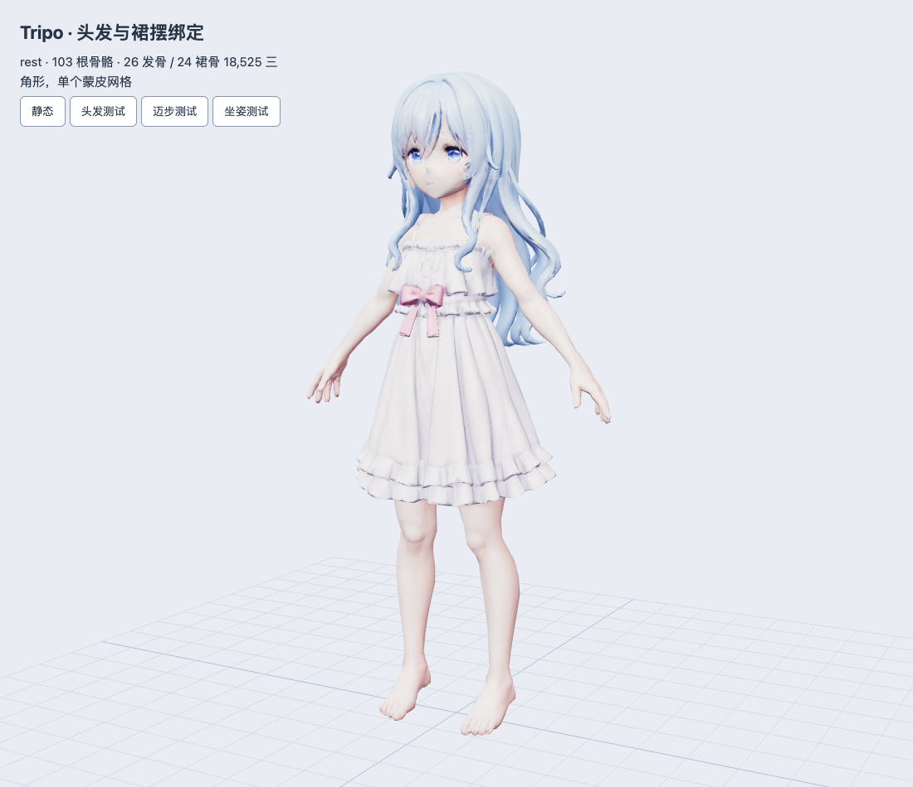
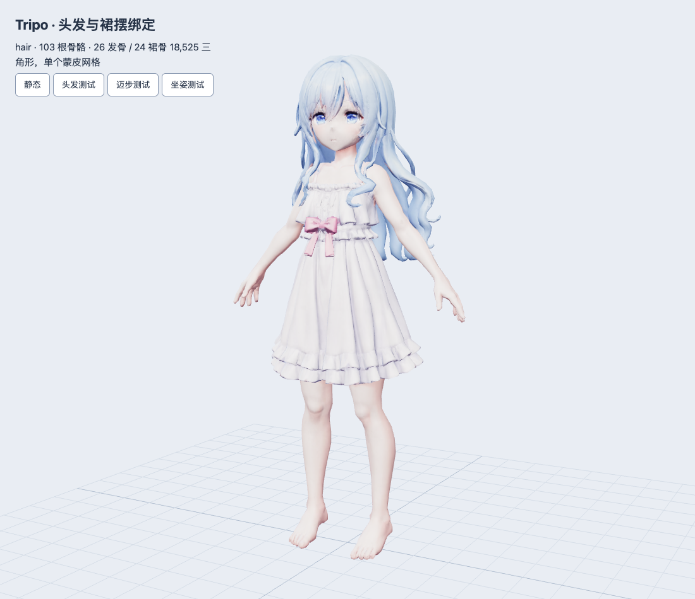
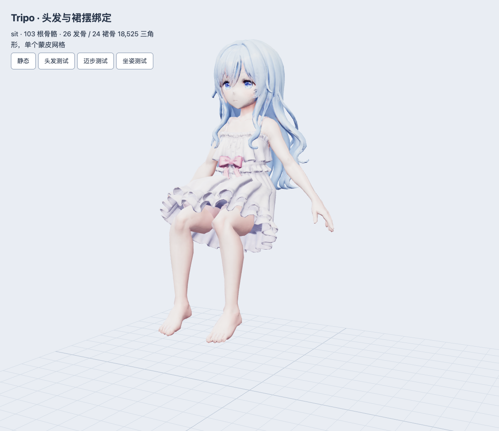

# Tripo 新人物：头发与裙摆绑定

本次只交付新模型的辅助骨骼与蒙皮，不切换应用角色。运行中的 `ResidentModel.tsx` 仍加载旧的 `luna.glb`。用户提供的 `anime girl character 3d model 2.glb` 保持原样。

| 交付物 | 用途 |
| --- | --- |
| [luna-tripo-secondary.blend](luna-tripo-secondary.blend) | 可编辑源文件，贴图已打包，含骨骼分组、区域标记及三段检查动作 |
| [luna-tripo-secondary.glb](../../../public/models/resident/luna-tripo-secondary.glb) | 普通 glTF 2.0 蒙皮模型，保留 103 根骨骼，不含测试动画或物理模拟 |
| [bone-map.json](bone-map.json) | 从最终 GLB 提取的辅助骨骼名称、父级、蒙皮索引和局部静态变换 |
| [validation.json](validation.json) | Blender 权重、姿势、原模型保持情况与导出回读检查 |
| [gltf-validation.json](gltf-validation.json)、[three-validation.json](three-validation.json) | Khronos glTF Validator 与 Three.js 加载检查 |

## 绑定结构

原有 53 根蒙皮骨骼的名称、父级和静态变换保留。新增 26 根发骨、24 根裙骨，总计 103 根；每顶点最多 4 个权重。源文件的 12 个非蒙皮末端节点也保留，不计入上述骨骼数量。

| 部位 | 骨链 | 父级与控制方式 |
| --- | --- | --- |
| 后发 | `Hair_Back_C/L/R_01…04` | 三条四节链，根部跟随 `mixamorig:Head` |
| 两侧长发 | `Hair_Side_L/R_01…04` | 两条四节链，根部跟随头部 |
| 前侧发束 | `Hair_Front_L/R_01…03` | 两条三节链，根部跟随头部 |
| 裙摆 | `Dress_Front`、`Front_L`、`Left`、`Back_L`、`Back`、`Back_R`、`Right`、`Front_R`，各 `_01…03` | 八条环绕三节链，根部跟随 `mixamorig:Hips`，腰部渐变固定，裙身与裙边分段变形 |

Blender 骨架中有 `Body`、`Hair`、`Dress` 三个 Bone Collection。网格保留 `Secondary_Hair_Region`、`Secondary_Dress_Region` 两个布尔属性，方便后续复查选择范围；GLB 使用标准蒙皮属性驱动，不依赖这些编辑标记。

按纹理、位置及焊接后的邻接关系识别区域，重分配 7,506 个头发顶点和 7,504 个裙摆顶点。UV 接缝两侧采用相同权重。修改区外 9,349 个顶点保持原权重；没有补建身体、重拓扑、改脸、改色或移动模型顶点。

清除了修改区域的手指、前臂串权重，以及裙摆的肩膀和手臂串权重。发束与肩背几何粘连处保留渐变连接权重，因此并非整片头发都只受头骨与发骨影响。直接把这些连接处全部改成头骨，会在转头时拉出尖角。

## 模型数据

| 项目 | 结果 |
| --- | --- |
| GLB 文件 | 9,057,764 bytes，约 8.64 MiB |
| 可编辑文件 | 8,887,568 bytes，约 8.48 MiB |
| 网格 / 材质 / Skin | 1 / 1 / 1 |
| 三角形 | 18,525，与源模型一致 |
| 顶点 | Blender 源几何 24,359；GLB 导出顶点 24,397，导出器按顶点属性拆分，空间形状和三角形数量不变 |
| 纹理 | 4096² 基础颜色、2048² 金属粗糙度、2048² 法线；三张嵌入图片与源文件字节完全一致 |
| 尺寸 | 原始站姿高度约 0.97894 个单位；未为了旧角色的身高缩放资源 |
| 坐标 | GLB 保留 Y 向上及原节点变换；Blender 检查使用 Z 向上 |
| 运行时动画 | 0；动作播放、弹簧摆动与碰撞需要后续接入 |
| 来源 | 用户提供的 Tripo 文件；未提供额外许可证，不归为 CC0 |

源 SHA-256：`c3dd0a6fed696a085e850b49dfee9297529b1856cc600f4948b9141792ab381f`。

输出 SHA-256：`3aa01d9319f692dbcf7685121b605837b46a94637be79fc5b7e077b1c27dbe32`。

## 检查动作与结果

打开 Blender 文件，选择 `Tripo_Resident_Rig`，在 Action Editor 选择以下动作。每段为 30 fps、1–120 帧，首尾回到静态姿势。它们用于检查蒙皮，不是正式游戏动作；GLB 导出时刻意不带入这些动作。

| 动作 / 检查 | 结果 |
| --- | --- |
| `Secondary_Hair_Check` | 转头与分段发链摆动；检查正面、背面和侧面；采样帧 UV 接缝无分离 |
| `Secondary_Dress_Walk_Check` | 左右迈步与裙链摆动；无非有限坐标、无接缝分离 |
| `Secondary_Dress_Sit_Check` | 髋、膝约 90° 的坐姿压力测试，裙链随腿部抬起；绑定可驱动，融合连接处仍有拉伸，不能视为正式坐姿验收 |
| 原人体骨骼、几何和 UV | 通过：骨骼静态矩阵和层级保留；Blender 几何最大误差 0，面索引一致；GLB 回读 UV 最大误差 0 |
| 蒙皮完整性 | 通过：0 个漏绑顶点，最多 4 权重，50 根新增骨骼都有非零影响；同位置 UV 接缝权重差为 0 |
| 小指独立旋转 | 通过：头发 / 裙摆最大数值位移约 `1.26e-7`，不再被小指牵动 |
| GLB 回读 | 通过：保留 103 根骨骼；静态最大误差约 `4.50e-7`，辅助骨骼姿势最大误差约 `1.93e-6` |
| Khronos Validator | 0 errors；2 个 warning 与源文件一致：缺少显式切线、蒙皮网格不是根节点。保留原节点层级，已另外通过实际加载验证 |
| Three.js r169 / 本机 Chrome | 静态、发链、迈步、坐姿均实际渲染；0 页面错误；`SkeletonUtils.clone` 创建独立骨架；1 个蒙皮网格、18,525 个三角形 |
| 实体手机、场景碰撞、完整动作 | 未测，本次没有应用代码改动 |

Three.js 的 GPU 纹理统计为 4，其中 3 张是材质图片，另 1 张是骨骼矩阵纹理。







## 已知限制与后续接入

源模型的头发、衣服和身体属于同一张连通网格，部分发束与肩背、裙底与腿部存在融合。当前用过渡权重保持连接连续，没有把缺失的遮挡表面凭空补出来。采样姿势中的最大单边长度比分别为头发 2.43、迈步 2.31、坐姿 3.39；99% 分位最大值约为 1.165、1.033、1.143。这说明局部融合处仍会拉伸，不能宣称大幅动作的变形质量已全部通过。需要大范围甩发、深蹲或近距离坐卧时，应先拆分这些粘连区域并补齐内侧表面，再精修权重。

后续可以先为发链添加轻量弹簧摆动，对裙链采用动作驱动与小幅二次摆动；身体、腿部和家具的简化碰撞体需单独实现。Blender 的布料 / 刚体模拟不会因为导出 GLB 就在 Three.js 自动运行，本文件没有声称包含这类效果。

应用适配时必须绕过旧 `rigResident()` 中的重绑、裁切和重建手臂逻辑，保留 GLB 的原生 `SkinnedMesh` 与 Skeleton，并用 `SkeletonUtils.clone` 隔离实例。Three.js r169 会把 `mixamorig:Hips` 等名称清理成 `mixamorigHips`；新增 `Hair_*` / `Dress_*` 名称不变。模型的约 0.979 单位身高与旧角色不同，座椅、床铺和书本接触点应随后按新骨架校准。本次没有实施这些应用变更。

## 重现与验证

脚本使用 Blender 5.2 自带的 Python、NumPy 和 glTF 导入导出器，不增加网页运行依赖。绑定脚本会核对源文件哈希，并拒绝覆盖已有输出；传入新的输出文件名。

```sh
blender --background --factory-startup --python scripts/blender/rig_tripo_secondary.py -- \
  --source /path/to/source.glb \
  --editable /tmp/luna-secondary-new.blend \
  --runtime /tmp/luna-secondary-new.glb

blender --background --factory-startup --python scripts/blender/validate_tripo_secondary.py -- \
  --source /path/to/source.glb \
  --editable /tmp/luna-secondary-new.blend \
  --runtime /tmp/luna-secondary-new.glb \
  --report /tmp/luna-secondary-validation.json
```

绑定及验证函数也可通过 Blender MCP 执行。它们创建独立场景并在结束后恢复先前场景，不保存或覆盖用户当前打开的工程。
